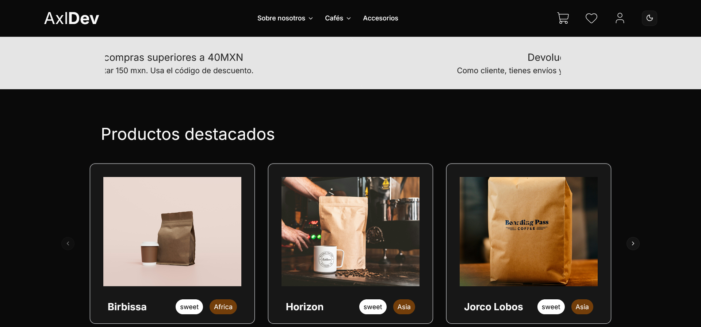
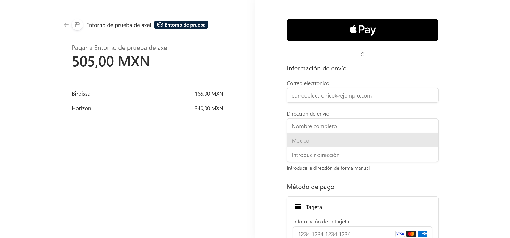

# ☕ Coffee E-Commerce — Frontend

Interfaz web de una tienda en línea especializada en café, construida bajo una arquitectura *Headless*. Este repositorio contiene toda la experiencia de usuario, gestión de estado del carrito, filtrado de productos y flujo de pagos seguros.

🔗 **Demo en vivo:** [Ver tienda desplegada en Vercel](https://ecommerce-coffe-65yf.vercel.app/)  
⚙️ **Repositorio Backend (Strapi):** [Ir al código del servidor](https://ecommerce-coffe-backend-6st6.onrender.com/admin/auth/login)

---

## 🛠️ Stack Tecnológico

* **Core:** Next.js 16 (App Router), React, TypeScript
* **Estilos y UI:** Tailwind CSS, Shadcn UI, Sonner (Notificaciones)
* **Estado Global:** Zustand (Persistencia del carrito de compras)
* **Consumo de API:** Axios
* **Pasarela de Pagos:** Stripe
* **Despliegue:** Vercel

---

## ✨ Funcionalidades Principales

* **Catálogo Dinámico:** Exploración de variedades de café con filtrado por categorías y detalles de producto.
* **Carrito de Compras Persistente:** Gestión rápida de cantidades, totales y almacenamiento local mediante **Zustand**.
* **Checkout Seguro:** Procesamiento de pagos reales e integración con sesiones de **Stripe**.
* **Feedback Visual:** Alertas interactivas no intrusivas con **Sonner** al agregar o modificar productos.
* **Diseño Responsivo:** Interfaz adaptada a dispositivos móviles y escritorio.

---

## 🚀 Instalación y Uso Local

1. **Clona el repositorio:**
   ```bash
   git clone https://github.com
   cd tu-repo-frontend
   ```

2. **Instala las dependencias:**
   ```bash
   npm install
   ```

3. **Configura las variables de entorno:**
   Crea un archivo `.env.local` en la raíz del proyecto y agrega las claves necesarias para conectar con tu backend y Stripe:
   ```env
   NEXT_PUBLIC_BACKEND_URL=http://localhost:1337
   NEXT_PUBLIC_STRIPE_PUBLISHABLE_KEY=tu_clave_publica_de_stripe
   STRIPE_SECRET_KEY=tu_clave_secreta_de_stripe
   ```

4. **Inicia el servidor de desarrollo:**
   ```bash
   npm run dev
   ```
   Abre [http://localhost:3000](http://localhost:3000) en tu navegador.

   
   
